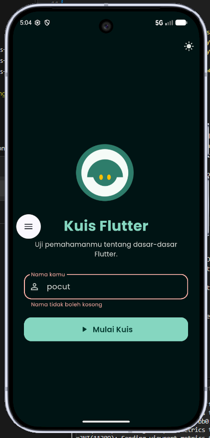
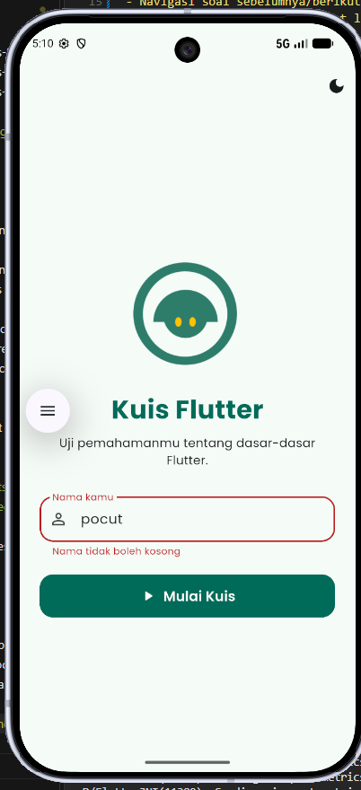
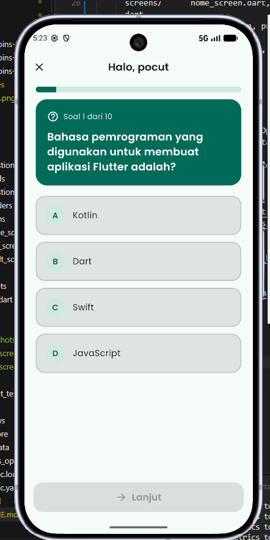
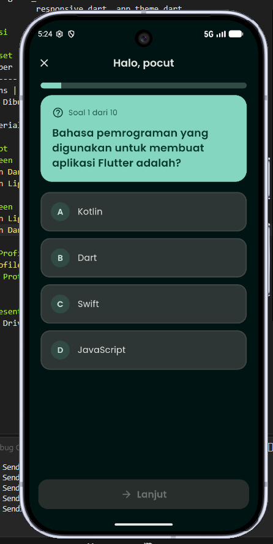
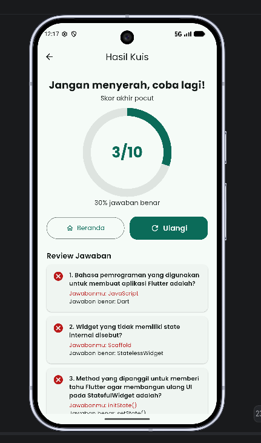
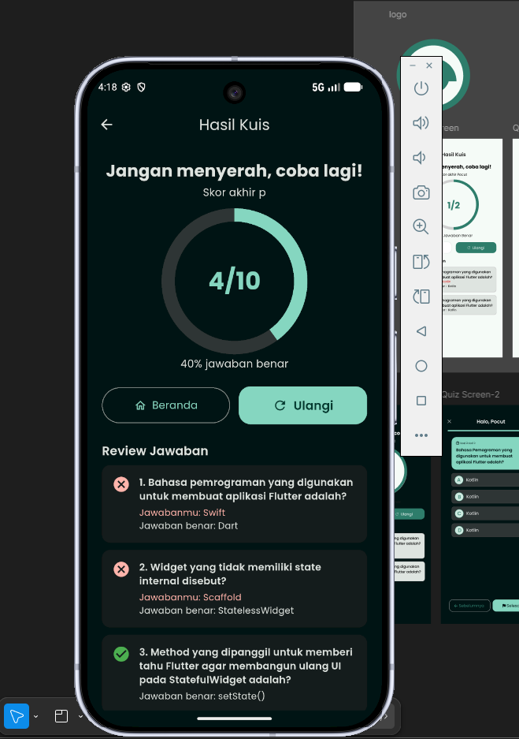

## UTS PEMMOB LAB 1
- Nama : Pocut Qanitah Putroe Azizull
- NIM  : 241401105
- Lab  : Pemrograman Mobile 1 (PM 1)

## Informasi Aplikasi
**Nama Aplikasi:** Kuis Flutter

**Deskripsi:** Aplikasi kuis pilihan ganda. Pengguna memasukkan nama, menjawab
10 pertanyaan seputar dasar Flutter, lalu melihat skor akhir beserta review jawaban.

**Fitur:**
- Input nama dengan validasi
- Soal pilihan ganda dengan progress bar
- Navigasi soal sebelumnya/berikutnya, jawaban bisa diubah
- Progres jawaban tersimpan saat layar dirotasi atau pindah halaman (Provider)
- Skor akhir, persentase, dan review benar/salah
- Dark / light mode

## Struktur Proyek
    lib/
      main.dart
      models/       question.dart
      data/         questions_data.dart
      providers/    quiz_provider.dart, theme_provider.dart
      screens/      home_screen.dart, quiz_screen.dart, result_screen.dart
      widgets/      answer_option, primary_button, question_card, quiz_progress_bar
      utils/        responsive.dart, app_theme.dart

## Dokumentasi
### Credit Aset
| Aset | Sumber |
|------|--------|
| Font Poppins | Google Fonts (SIL Open Font License) |
|  |
| Ikon | Material Icons bawaan Flutter |

### Screenshot
### Home Screen

### Quiz Screen

### Result Screen

### Mockup / Prototype
[(link Figma)](https://www.figma.com/design/DsPeNRf2ET3nXChGMjEjr2/pemmob?node-id=0-1&t=k4GBsEhORuoShyRk-1)

### Video Presentasi
https://drive.google.com/file/d/1cvSugx3dmH8i3-veB4Qet7M9u4UBHTy7/view?usp=sharing

